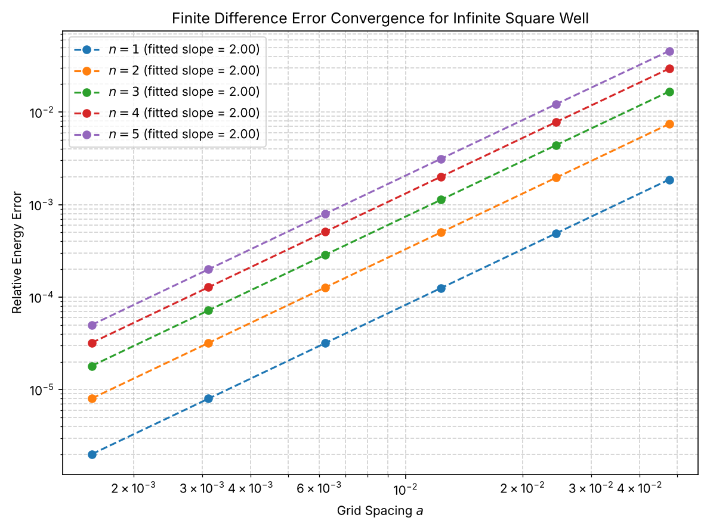
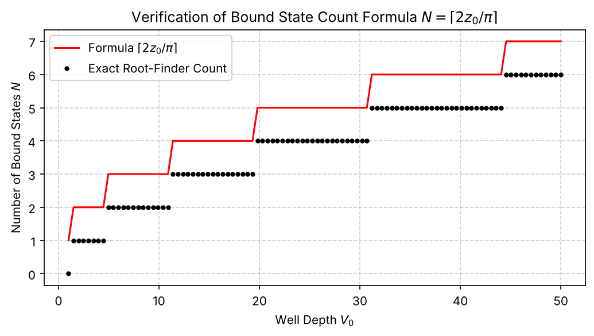
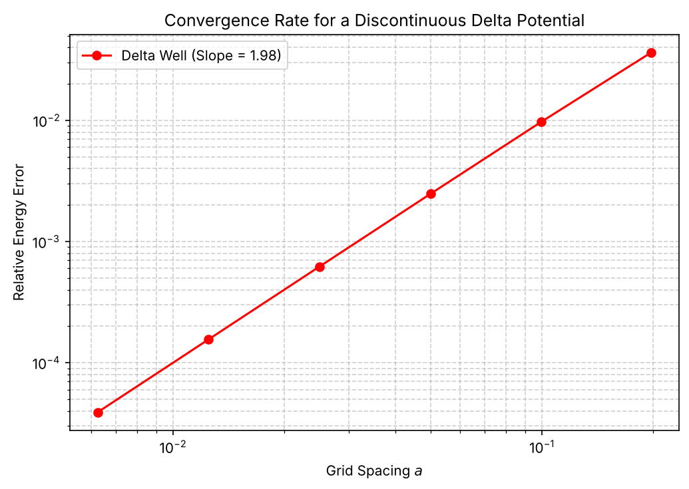

# Quantum Mechanics on a Grid: Equations, Results and Graphs

This README explains **every equation used in `quantum_mechanics_on_grid.ipynb`**, in the order the notebook uses them.
All numbers and graphs shown are **only those produced by the notebook itself**:

- the printed outputs saved in the notebook (copied exactly), and
- the three plots stored in the notebook (extracted unchanged into `images/`).

Where the notebook computes something but prints or plots nothing, this README says so instead of adding new results.
Cell numbers are code-cell numbers counted from 1 (cell 1 = the imports cell).
Equations are written in LaTeX and display correctly on GitHub, VS Code and Jupyter.

**Contents**

1. [Setup and units (cell 1)](#1-setup-and-units-cell-1)
2. [Finite-difference Hamiltonian (cell 2)](#2-finite-difference-hamiltonian-cell-2)
3. [Infinite square well and convergence order (cells 2–3)](#3-infinite-square-well-and-convergence-order-cells-23)
4. [Finite square well (cells 4–5)](#4-finite-square-well-cells-45)
5. [Harmonic oscillator (cell 6)](#5-harmonic-oscillator-cell-6)
6. [Delta-function well (cells 7–8)](#6-delta-function-well-cells-78)
7. [GaAs/AlGaAs heterostructure with position-dependent mass (cells 9–13)](#7-gaasalgaas-heterostructure-with-position-dependent-mass-cells-913)
8. [Time evolution of a Gaussian wave packet (cells 14–17)](#8-time-evolution-of-a-gaussian-wave-packet-cells-1417)
9. [Tunnelling through a rectangular barrier (cells 18–19)](#9-tunnelling-through-a-rectangular-barrier-cells-1819)
10. [Quantum-dot level spacings and thermal energy (cells 20–22)](#10-quantum-dot-level-spacings-and-thermal-energy-cells-2022)
11. [Summary table of all equations](#11-summary-table-of-all-equations)

---

## 1. Setup and units (cell 1)

The notebook imports `numpy`, `matplotlib`, and from `scipy`: `eigh`, `eigh_tridiagonal`, `brentq` and `solve_banded` (it also imports `diags` and `eigsh`, which are not used).

It then sets natural units for the model problems:

$\hbar $= 1, $\qquad$ m = 1\ (\texttt{m\_eff}),\qquad L = 1.0 .$$

In these units the energy unit is $\hbar^2/(mL^2)$. Sections 7 and 10 switch to physical units (eV and nm) with
$\hbar^2/2m_0 = 0.0381\ \text{eV nm}^2$, where $m_0$ is the free-electron mass.

---

## 2. Finite-difference Hamiltonian (cell 2)

This is the engine used by almost every experiment (function `hamilton_fun`).

### Equation 1: time-independent Schrödinger equation

$$-\frac{\hbar^2}{2m}\frac{d^2\psi}{dx^2}+V(x)\,\psi(x)=E\,\psi(x)$$

- $\psi(x)$ is the wavefunction, $|\psi|^2$ the probability density, so a bound state is normalised: $\int|\psi|^2dx=1$.
- $V(x)$ is the potential energy, $E$ the energy eigenvalue, $m$ the (effective) mass.
- It is an eigenvalue problem: only special values of $E$ allow a solution that satisfies the boundary conditions.

### Equation 2: the grid

$$a=\frac{L}{N+1},\qquad x_j=j\,a\quad(j=1,\dots,N),\qquad \psi_0=\psi_{N+1}=0$$

- The box of length $L$ is cut into $N+1$ equal cells of width $a$; the $N$ interior points are the unknowns.
- The wavefunction is forced to zero at both walls, which is why the denominator is $N+1$, not $N$.
- Code: `a = L/(N+1)`, `x = np.linspace(a, L-a, N)`.

### Equation 3: three-point second derivative

$$\frac{d^2\psi}{dx^2}\bigg|_{x_j}\approx\frac{\psi_{j+1}-2\psi_j+\psi_{j-1}}{a^2}$$

- Adding the Taylor expansions of $\psi(x_j\pm a)$ gives this formula with an error term proportional to $a^2$:
  $-\frac{a^2}{12}\psi^{(4)}(x_j)$. The method is therefore **second-order accurate**.

### Equation 4: the tridiagonal matrix

$$t=\frac{\hbar^2}{2ma^2},\qquad -t\,\psi_{j-1}+(2t+V_j)\,\psi_j-t\,\psi_{j+1}=E\,\psi_j$$

- Substituting Equation 3 into Equation 1 turns the differential equation into a matrix eigenvalue problem $H\boldsymbol\psi=E\boldsymbol\psi$.
- $t$ is the "hopping energy": the kinetic term couples each point only to its two neighbours.
- $H$ has $2t+V_j$ on the main diagonal and $-t$ on the two neighbouring diagonals (code: `diag = 2*t + V`, `off_diag = -t*np.ones(N-1)`).
- A symmetric tridiagonal matrix is solved efficiently by `eigh_tridiagonal`; `select='i'` returns only the lowest `num_levels` eigenvalues.
- The `'dense'` option in `hamilton_fun` is meant to build the same matrix with `np.diag` and use `eigh`; it is never called in the notebook.

---

## 3. Infinite square well and convergence order (cells 2–3)

### Equation 5: exact levels of the infinite well

$$E_n=\frac{\hbar^2\pi^2n^2}{2mL^2},\qquad n=1,2,3,\dots$$

- With $V=0$ inside the box and $\psi=0$ on the walls the solutions are $\psi_n=\sqrt{2/L}\,\sin(n\pi x/L)$; the energy grows as $n^2$.
- Code: `exact_energy(n)`. In the code the prefactor is written `hbar**2 / 2*m_eff`; because $m=1$ this equals the correct value here, but Python evaluates it as $(\hbar^2/2)\cdot m$, so it would be wrong for $m\neq1$.

### Equation 6: relative error

$$\varepsilon_n=\left|\frac{E_n^{\text{num}}-E_n^{\text{exact}}}{E_n^{\text{exact}}}\right|$$

The notebook computes this for the lowest five levels with $N=20,40,80,160,320,640$ (so $a$ halves each time).

### Equation 7: convergence order from a log–log fit

$$\varepsilon_n\simeq C_n\,a^{p}\quad\Longrightarrow\quad\ln\varepsilon_n=p\,\ln a+\ln C_n$$

- If the error follows a power law in $a$, the points lie on a straight line in a log–log plot and the **slope $p$ is the order of the method**.
- Code: `np.polyfit(np.log(a_values), np.log(err_n), 1)`. Because of Equation 3, $p=2$ is expected.

### Results (notebook output, cell 3)

```
Fitted Slopes (Convergence Order):
  Level n=1: 1.9998
  Level n=2: 1.9993
  Level n=3: 1.9984
  Level n=4: 1.9971
  Level n=5: 1.9955
```



*Graph from the notebook (cell 3): relative energy error against grid spacing for $n=1\ldots5$. All five lines are straight with slope ≈ 2.*

**Reading the result.** The slopes are 1.9955–1.9998, confirming second-order convergence. Higher levels have errors a little larger (their lines sit higher) and slopes slightly below 2.

---

## 4. Finite square well (cells 4–5)

A well of depth $V_0$ and width $L$. Inside the well the solution oscillates, outside it decays; matching $\psi$ and $\psi'$ at the walls gives conditions that have to be solved numerically. The notebook uses the dimensionless variables below (function `exact_finite_well`).

### Equation 8: dimensionless well strength and energy

$$z=\frac{kL}{2},\qquad z_0=\frac{L}{2\hbar}\sqrt{2mV_0},\qquad E=\frac{(2\hbar z/L)^2}{2m}-V_0$$

- $k$ is the wave-number inside the well, so $\hbar^2k^2/2m$ is the kinetic energy measured from the bottom of the well.
- $z_0$ measures how deep and wide the well is; a larger $z_0$ means more bound states.
- Subtracting $V_0$ expresses the energy relative to the top of the well (bound states have $E<0$). Code: `E_sol = (2*hbar*z_sol/L)**2/(2*m_eff) - V0`.

### Equation 9: even and odd states

$$\text{even:}\ \tan z=\sqrt{\left(\frac{z_0}{z}\right)^2-1},\qquad \text{odd:}\ -\cot z=\sqrt{\left(\frac{z_0}{z}\right)^2-1}$$

- Even states have $\psi(-x)=\psi(x)$, odd states $\psi(-x)=-\psi(x)$; they alternate with increasing energy.
- The notebook looks for one root of each equation in the interval $[n\pi/2,(n+1)\pi/2]$ using Brent's method (`brentq`): even equation for even $n$, odd equation for odd $n$.
- The square root is real only for $z\le z_0$.

### Equation 10: number of bound states

$$N_{\text{bound}}=\left\lceil\frac{2z_0}{\pi}\right\rceil$$

- Each interval of length $\pi/2$ that starts below $z_0$ holds one root, so the count is $z_0$ divided by $\pi/2$, rounded up. At least one bound state always exists.
- The notebook checks this for 100 values of $V_0$ between 1 and 50 with $L=2$ (red line = formula, black dots = number of roots found).
- Cell 4 prints no results; it only produces numerical warnings (division by zero and square root of negative numbers) that come from evaluating the functions at the ends of the search intervals.

### Result (notebook plot, cell 5)



*Graph from the notebook (cell 5): number of bound states against well depth $V_0$.*

**Reading the result.** The red staircase from Equation 10 steps up each time $V_0$ crosses a threshold, and the black points reproduce the staircase shape and the positions of the steps. In the plot the black dots lie one level **below** the red line for every $V_0$ (they start at 0 where the formula gives 1). The code explains this: the search interval for $n=0$ starts at $z=0$, where the function is infinite, `brentq` raises a `ValueError`, and the `except ValueError: pass` line hides it, so the lowest state is not counted.

---

## 5. Harmonic oscillator (cell 6)

### Equation 11: oscillator potential and exact levels

$$V(x)=\tfrac12 m\omega^2x^2,\qquad E_n=\hbar\omega\left(n+\tfrac12\right),\quad n=0,1,2,\dots$$

- The potential is a parabola with frequency $\omega$; it is added to the diagonal of the matrix from Equation 4 (code: `V0 = 0.5*m_eff*omega**2*x_0**2`).
- The exact spectrum is evenly spaced by $\hbar\omega$ with a zero-point energy $\hbar\omega/2$ in the lowest state.
- Numerical settings: $\omega=1$, domain $[-10,10]$, $N=1000$ (so $a\approx0.02$); the ten lowest levels are computed and the first five printed.

### Results (notebook output, cell 6)

| n | Numerical | Exact |
|---|-----------|-------|
| 0 | 0.49999 | 0.50000 |
| 1 | 1.49994 | 1.50000 |
| 2 | 2.49984 | 2.50000 |
| 3 | 3.49969 | 3.50000 |
| 4 | 4.49949 | 4.50000 |

(Raw output: `n=0: Numerical = 0.49999, Exact = 0.50000` … `n=4: Numerical = 4.49949, Exact = 4.50000`.)

**Reading the result.** The numerical levels agree with $\hbar\omega(n+\tfrac12)$ to four decimals. The difference grows with $n$ (0.00001, 0.00006, 0.00016, 0.00031, 0.00051) and is always on the low side. The notebook makes no plot for this section.

---

## 6. Delta-function well (cells 7–8)

### Equation 12: delta potential and its exact bound state

$$V(x)=-\alpha\,\delta(x),\qquad E_0=-\frac{m\alpha^2}{2\hbar^2},\qquad \psi_0(x)=\sqrt{\kappa}\,e^{-\kappa|x|},\ \ \kappa=\frac{m\alpha}{\hbar^2}$$

- A delta function is an infinitely narrow, infinitely deep spike of "area" $\alpha$; it supports exactly **one** bound state.
- With $\alpha=2$, $m=\hbar=1$ the exact energy is $E_0=-2$ (code: `exact_delta_E`).

### Equation 13: delta function on a grid

$$V_j=-\frac{\alpha}{a}\ \text{ at the grid point nearest } x=0,\qquad V_j=0 \text{ elsewhere}$$

- A delta function has no grid value, so its strength is put on one point and divided by $a$, so that the integral of $V$ over one cell, $V_j\cdot a$, equals $-\alpha$. As $a\to0$ the spike becomes narrower and deeper, like the true delta.
- The notebook runs $N=100,200,400,800,1600,3200$ on a domain of length $D=20$, takes the lowest negative eigenvalue as the bound state, and measures the relative error as in Equation 6 and the slope as in Equation 7.

### Results (notebook output, cell 7)

```
--- Delta Well Convergence ---
Fitted convergence slope for Delta Potential: 1.98 (Expected ~1.0 due to derivative discontinuity)
```



*Graph from the notebook (cell 8): relative energy error of the delta-well ground state against grid spacing (slope 1.98).*

**Reading the result.** The points fall on a straight line of slope 1.98, i.e. second-order convergence, even though the wavefunction has a cusp at the origin. The text printed in the notebook says a slope of about 1.0 is expected; the measured value shown by the notebook is 1.98.

---

## 7. GaAs/AlGaAs heterostructure with position-dependent mass (cells 9–13)

An electron in a 5 nm GaAs layer between AlGaAs barriers. Parameters (cell 9): $m^*_{\text{GaAs}}=0.067\,m_0$, $m^*_{\text{AlGaAs}}=0.092\,m_0$, barrier height $V_0=0.30$ eV, well width 5 nm (from $-2.5$ to $2.5$ nm), domain 30 nm, $N=1500$, $\hbar^2/2m_0=0.0381$ eV nm².

### Equation 14: BenDaniel–Duke Hamiltonian

$$\hat H=-\frac{\hbar^2}{2}\,\frac{d}{dx}\!\left(\frac{1}{m^*(x)}\frac{d\psi}{dx}\right)+V(x)\,\psi$$

- When the mass changes with position, $-\frac{\hbar^2}{2m^*(x)}\psi''$ would not be Hermitian. Putting $1/m^*$ **between** the derivatives restores it.
- It implies two interface conditions: $\psi$ continuous, and the **flux** $\frac{1}{m^*}\frac{d\psi}{dx}$ continuous. The slope $\psi'$ itself therefore jumps at the interface.
- Potential in the code: $V=0$ for $|x|\le2.5$ nm and $V_0$ outside.

### Equation 15: discretisation on bonds

$$-t_{j-\frac12}\,\psi_{j-1}+\left(t_{j-\frac12}+t_{j+\frac12}+V_j\right)\psi_j-t_{j+\frac12}\,\psi_{j+1}=E\,\psi_j,\qquad t_{j+\frac12}=\frac{\hbar^2/2m_0}{a^2\,m_{j+1/2}}$$

- The mass is evaluated on the **bond** between points $j$ and $j+1$, so each bond has its own hopping $t_{j+1/2}$. The diagonal is the sum of the hoppings of the two neighbouring bonds (code: `t_left_bonds + t_right_bonds + V`), the off-diagonal is $-t_{j+1/2}$.
- When all masses are equal this reduces to Equation 4.

### Equation 16: how the bond mass is chosen

$$\text{BenDaniel–Duke (harmonic mean):}\ \ m_{j+\frac12}=\frac{2\,m_j m_{j+1}}{m_j+m_{j+1}},\qquad
\text{arithmetic mean:}\ \ m_{j+\frac12}=\frac{m_j+m_{j+1}}{2}$$

- The harmonic mean is the average of $1/m$: $\frac1{m_{j+1/2}}=\frac12\left(\frac1{m_j}+\frac1{m_{j+1}}\right)$, which is the natural choice when the operator contains $1/m^*$ (cell 9, `m_bonds`).
- Cell 10 is the **naive** model: $t=\frac{\hbar^2/2m_0}{a^2m_{\text{GaAs}}}$ with the well mass everywhere (ordinary Equation 4).
- Cell 11 uses the arithmetic mean (`m_bonds_arith`).

### Equation 17: discrete flux

$$J_{j+\frac12}=\frac{\psi_{j+1}-\psi_j}{a\,m_{j+1/2}}$$

- This is the discrete version of $\frac1{m^*}\frac{d\psi}{dx}$. Cell 13 evaluates it two bonds inside the well and two bonds outside the interface at $x=2.5$ nm to test whether it is continuous.

### Results (notebook output, cells 12 and 13)

```
--- Ground State Energy ($E_1$) Comparison ---
BenDaniel-Duke (Correct):       0.12332 eV
Naive Constant Mass:            0.08970 eV (Shift: -0.03362 eV)
Arithmetic Mean Discretization: 0.08368 eV (Shift: -0.03963 eV)

--- Interface Flux Continuity Check ---
Flux just inside well (BD):     -0.21384
Flux just outside barrier (BD): -0.20935 (Continuous!)
Flux just inside well (Arith):  -0.21384
Flux outside barrier (Arith):   -0.20935 (Discontinuous!)
```

The notebook makes no plot for this section.

**Reading the result, and observations on the code as written.**

- The notebook reports a ground-state energy of 0.12332 eV for BenDaniel–Duke, with the other two schemes lower by 0.034 and 0.040 eV.
- The BenDaniel–Duke hopping in cell 9 is written `t_bonds = 2*hbar2_over_2m0 / (a**2 * m_bonds)`. Equation 15 has no factor 2, and the constant-mass and arithmetic cells (10 and 11) do not use one. This difference enters only the BenDaniel–Duke energy.
- The node mass is built with `np.where(np.abs(x <= 2.0), ...)`. The expression `x <= 2.0` is a boolean array and `np.abs` leaves it unchanged, so the mass switches at $|x|=2.0$ nm, while the potential in the same cell switches at $|x|=2.5$ nm ($L_{\text{well}}/2$).
- In cell 13 both fluxes use the same wavefunction (`psi_1`, from the BenDaniel–Duke run) and differ only in the bond mass used in the denominator; inside and outside the interface the two bond masses coincide there, so the printed numbers are identical. The words "Continuous!" and "Discontinuous!" are fixed text in the print statements, not results of a test.

---

## 8. Time evolution of a Gaussian wave packet (cells 14–17)

### Equation 18: time-dependent Schrödinger equation and its exact solution

$$i\hbar\frac{\partial\psi}{\partial t}=\hat H\psi\quad\Longrightarrow\quad\psi(t+\Delta t)=e^{-i\hat H\Delta t/\hbar}\,\psi(t)$$

- The evolution operator $e^{-i\hat H\Delta t/\hbar}$ is **unitary**: it keeps $\sum|\psi|^2a=1$ for all times. A numerical scheme is judged by whether it preserves this.
- Setup (cell 14): domain 40, $N=1000$, $\Delta t=0.02$, 300 steps (so $t_{\text{final}}=6$).

### Equation 19: initial Gaussian packet

$$\psi_0(x)=\frac{1}{(2\pi\sigma_0^2)^{1/4}}\;e^{-(x-x_0)^2/4\sigma_0^2}\;e^{ik_0x},\qquad x_0=-10,\ \sigma_0=1.5,\ k_0=2$$

- The real Gaussian envelope has width $\sigma_0$ (the standard deviation of $|\psi|^2$) and is centred at $x_0$; the phase factor $e^{ik_0x}$ gives it mean momentum $\hbar k_0$, i.e. velocity $\hbar k_0/m$ to the right.
- The code then renormalises on the grid: `psi_0 /= sqrt(sum(|psi_0|^2)*a)`.

### Equation 20: Hamiltonian action and energy expectation (cell 15)

$$(H\psi)_j=2t\,\psi_j-t\,\psi_{j+1}-t\,\psi_{j-1},\qquad \langle H\rangle=a\sum_j\psi_j^*\,(H\psi)_j$$

- `apply_H` is Equation 4 with $V=0$ (free particle) written as a matrix-free operation. `compute_energy` and the loops use the second expression for the mean energy.

### Equation 21: explicit Euler step (cell 16)

$$\psi^{n+1}=\psi^n\mp\frac{\Delta t}{i\hbar}\hat H\psi^n,\qquad \text{amplification of an energy-}E\text{ component: } \sqrt{1+\left(\frac{\Delta t\,E}{\hbar}\right)^2}>1$$

- Explicit Euler is the first-order Taylor expansion of Equation 18. Each energy component of the state is multiplied by a number larger than 1 in modulus at every step, regardless of $\Delta t$, so the norm grows instead of staying at 1. The cell is a deliberate **instability demonstration**.
- The notebook's update line is `psi_ee = psi_ee - (dt/(1j*hbar)) * apply_H(psi_ee)` (minus sign, as printed in its comment). The correct explicit step has the opposite sign; the amplification factor above is the same for both signs.
- The norms are stored in `norms_ee`. The cell prints nothing except numerical overflow warnings, and the notebook does not plot `norms_ee`.

### Equation 22: Crank–Nicolson step (cell 17)

$$\left(1+\frac{i\Delta t}{2\hbar}\hat H\right)\psi^{n+1}=\left(1-\frac{i\Delta t}{2\hbar}\hat H\right)\psi^n$$

- Averaging $\hat H$ over the old and new time levels. The factor that multiplies each energy component is $\dfrac{1-i\theta}{1+i\theta}$ with $\theta=\Delta tE/2\hbar$, which has modulus exactly 1, so the scheme is unitary and stable for any $\Delta t$.
- Code: `alpha = 1j*dt/(2*hbar)`; the left matrix is tridiagonal with diagonal $1+\alpha\,(2t)$ and off-diagonals $\alpha(-t)$ (`ab_lhs`), the right side is `b = psi - alpha*apply_H(psi)`, and `solve_banded` solves the tridiagonal system in O(N) work per step.

### Equation 23: observables recorded at every step

$$\text{norm}=a\sum_j|\psi_j|^2,\qquad \langle x\rangle=a\sum_jx_j|\psi_j|^2,\qquad \sigma=\sqrt{\langle x^2\rangle-\langle x\rangle^2},\qquad \langle H\rangle \text{ as in Eq. 20}$$

- The norm tests unitarity, $\langle H\rangle$ tests energy conservation, and $\sigma$ is the width of the packet, which for a free particle should grow because the different momentum components move at different speeds (dispersion).

### Result (notebook output, cell 17)

```
Simulation completed successfully! Final Norm: 1.0000000000000886
```

**Reading the result.** After 300 Crank–Nicolson steps the norm is 1 to within $9\times10^{-14}$, as expected for a unitary scheme. The arrays `norms_cn`, `energies_cn` and `widths_cn` are filled in the notebook, but the notebook prints and plots only this final norm, so no energy or width values are shown here.

---

## 9. Tunnelling through a rectangular barrier (cells 18–19)

A rectangular barrier of height $V_0=2$ and width $w=2$, centred at $x=0$ (`V = np.where(|x| <= w/2, V0, 0)`), is hit by the Gaussian packet of Section 8 for 25 values of $k_0$ from 0.5 to 3.5. The incident energy is

### Equation 24: incident energy

$$E_0=\frac{\hbar^2k_0^2}{2m}$$

### Equation 25: analytic transmission, $E_0<V_0$ (tunnelling)

$$T=\left[1+\frac{V_0^2\sinh^2(\kappa w)}{4E_0\,(V_0-E_0)}\right]^{-1},\qquad \kappa=\frac{\sqrt{2m(V_0-E_0)}}{\hbar}$$

- Inside the barrier the wave decays like $e^{-\kappa x}$, so the transmission falls roughly as $e^{-2\kappa w}$: it is small but non-zero. This is quantum tunnelling.

### Equation 26: analytic transmission, $E_0>V_0$

$$T=\left[1+\frac{V_0^2\sin^2(k'w)}{4E_0\,(E_0-V_0)}\right]^{-1},\qquad k'=\frac{\sqrt{2m(E_0-V_0)}}{\hbar}$$

- Above the barrier the wave oscillates inside it. $T=1$ whenever $k'w=n\pi$ (the barrier is perfectly transparent: a resonance), otherwise $T<1$ because of partial reflection at the two edges.
- At exactly $E_0=V_0$ both formulas are of the form 0/0, which the code does not treat separately. This is why the notebook's table shows **nan** at $k_0=2$ ($E_0=2.0000$).

### Equation 27: numerical transmission

$$T_{\text{num}}=a\sum_{x_j>w/2}|\psi_j|^2$$

- The packet is propagated with the Crank–Nicolson step (Equation 22) for 300 steps and the probability to the right of the barrier is summed (`right_mask = x > w_barrier/2`).

### Results (notebook output, cell 19)

```
k0       | Energy (E0)  | Numerical T    | Analytical T
-------------------------------------------------------
0.50     | 0.1250       | 0.0007         | 0.0004
0.62     | 0.1953       | 0.0019         | 0.0007
0.75     | 0.2812       | 0.0046         | 0.0012
0.88     | 0.3828       | 0.0107         | 0.0019
1.00     | 0.5000       | 0.0226         | 0.0029
1.12     | 0.6328       | 0.0443         | 0.0046
1.25     | 0.7812       | 0.0803         | 0.0074
1.38     | 0.9453       | 0.1349         | 0.0119
1.50     | 1.1250       | 0.2107         | 0.0196
1.62     | 1.3203       | 0.3070         | 0.0334
1.75     | 1.5312       | 0.4188         | 0.0586
1.88     | 1.7578       | 0.5377         | 0.1068
2.00     | 2.0000       | 0.6533         | nan
2.12     | 2.2578       | 0.7561         | 0.3722
2.25     | 2.5312       | 0.8397         | 0.6335
2.38     | 2.8203       | 0.9020         | 0.8851
2.50     | 3.1250       | 0.9443         | 0.9944
2.62     | 3.4453       | 0.9707         | 0.9870
2.75     | 3.7812       | 0.9858         | 0.9506
2.88     | 4.1328       | 0.9936         | 0.9266
3.00     | 4.5000       | 0.9974         | 0.9226
3.12     | 4.8828       | 0.9990         | 0.9342
3.25     | 5.2812       | 0.9996         | 0.9538
3.38     | 5.6953       | 0.9999         | 0.9741
3.50     | 6.1250       | 1.0000         | 0.9897
```

The notebook makes no plot for this section.

**Reading the result.** The analytical column shows the expected physics: a very small tunnelling probability at low energy (0.0004 at $k_0=0.5$), a steep rise as $E_0$ approaches $V_0=2$, a maximum near 0.994 at $k_0=2.5$ (a resonance) and a slight dip to about 0.92 around $k_0=3$ before rising again. The numerical column is larger than the analytic one at low $k_0$ (for example 0.0226 against 0.0029 at $k_0=1$) and rises smoothly with no resonance structure.

**Observation on the code as written.** In cell 18 the array `V` for the barrier is created, but the time-stepping loop calls `apply_H` and uses `ab_lhs`, which were built in cells 15 and 17 for the free particle ($V=0$). The barrier therefore does not enter the propagation, and the "Numerical T" column is the share of a free packet found beyond $x=1$ after $t=6$. For instance, a free packet with $k_0=2$ has its centre at $x\approx2$ at $t=6$, and the table gives 0.6533 for it.

---

## 10. Quantum-dot level spacings and thermal energy (cells 20–22)

### Equation 28: dot as an infinite box with effective mass

$$t=\frac{\hbar^2/2m_0}{m^*\,a^2},\qquad a=\frac{L}{N+1},\qquad E_n=\frac{\hbar^2\pi^2n^2}{2m^*L^2}$$

- A quantum dot is modelled as a 1D infinite well of length $L$ in a material with effective mass $m^*$ (GaAs: $0.067\,m_0$; silicon transverse: $0.19\,m_0$).
- Cell 21 builds the full $1000\times1000$ matrix with $2t$ on the diagonal and $-t$ next to it, and diagonalises it with `scipy.linalg.eigh` (this is Equation 4 with $V=0$). Units are eV and nm with $\hbar^2/2m_0=0.0380998243$ eV nm².

### Equation 29: level spacing

$$\Delta E=E_2-E_1$$

- For the infinite box $E_n\propto n^2$, so $\Delta E=3E_1$; both scale as $1/(m^*L^2)$: smaller or lighter-mass dots have larger spacing.

### Equation 30: thermal energy and the criterion used

$$k_BT\quad(k_B=8.617333262\times10^{-5}\ \text{eV/K}),\qquad \Delta E>10\,k_BT\ \text{ at 4 K }\Rightarrow\ \text{"Safe at 4K"}$$

- For a dot to behave as a quantum system its level spacing must be larger than the thermal energy that could excite electrons between levels.
- In the code the test is `delta_E_meV > 10 * kT_4K_meV`; otherwise the label is "Needs 1K/20mK".

### Results (notebook output, cell 22)

```
Material           | L (nm)   | E1 (meV)   | ΔE (meV)   | Thermal Comparison
---------------------------------------------------------------------------
GaAs               | 20       | 14.03      | 42.09      | ΔE >> kB*T (Safe at 4K)
GaAs               | 50       | 2.24       | 6.73       | ΔE >> kB*T (Safe at 4K)
GaAs               | 100      | 0.56       | 1.68       | ΔE > kB*T (Needs 1K/20mK)
Si (transverse)    | 20       | 4.95       | 14.84      | ΔE >> kB*T (Safe at 4K)
Si (transverse)    | 50       | 0.79       | 2.37       | ΔE > kB*T (Needs 1K/20mK)
Si (transverse)    | 100      | 0.20       | 0.59       | ΔE > kB*T (Needs 1K/20mK)
---------------------------------------------------------------------------
Reference thermal energies (kB * T):
  4 K: 0.3447 meV
  1 K: 0.0862 meV
  20 mK: 0.0017 meV
```

The notebook makes no plot for this section.

**Reading the result.** The spacing falls from 42.09 meV (GaAs, 20 nm) to 0.59 meV (Si, 100 nm) as $L$ grows; in every row $\Delta E\approx3E_1$ (for example $3\times14.03=42.09$). The 4 K thermal energy is 0.3447 meV, so ten times that is 3.447 meV; the notebook's rule therefore labels GaAs 20 nm and 50 nm and Si 20 nm as safe at 4 K, and the other three dots as needing 1 K or 20 mK.

---

## 11. Summary table of all equations

| # | Equation | Where used | Notebook cell |
|---|----------|-----------|---------------|
| 1 | $-\frac{\hbar^2}{2m}\psi''+V\psi=E\psi$ | all stationary problems | 2 |
| 2 | $a=L/(N+1)$, $\psi_0=\psi_{N+1}=0$ | all grids | 2, 6, 7, 9, 14, 21 |
| 3 | $\psi''\approx(\psi_{j+1}-2\psi_j+\psi_{j-1})/a^2$ | derivation of the matrix | 2 |
| 4 | $t=\hbar^2/2ma^2$; $-t\psi_{j-1}+(2t+V_j)\psi_j-t\psi_{j+1}=E\psi_j$ | matrix Hamiltonian | 2, 6, 7, 10, 15, 21 |
| 5 | $E_n=\hbar^2\pi^2n^2/2mL^2$ | infinite well reference | 2 |
| 6 | $\varepsilon_n=\lvert E^{\rm num}-E^{\rm exact}\rvert/E^{\rm exact}$ | error measure | 2, 7 |
| 7 | $\ln\varepsilon=p\ln a+\ln C$ | convergence order | 3, 7 |
| 8 | $z=kL/2$, $z_0=\frac{L}{2\hbar}\sqrt{2mV_0}$, $E=(2\hbar z/L)^2/2m-V_0$ | finite well | 4 |
| 9 | $\tan z=\sqrt{(z_0/z)^2-1}$, $-\cot z=\sqrt{(z_0/z)^2-1}$ | finite well roots | 4 |
| 10 | $N=\lceil2z_0/\pi\rceil$ | bound-state count | 4, 5 |
| 11 | $V=\frac12m\omega^2x^2$, $E_n=\hbar\omega(n+\frac12)$ | oscillator | 6 |
| 12 | $E_0=-m\alpha^2/2\hbar^2$ | delta well exact | 7 |
| 13 | $V_j=-\alpha/a$ at one node | delta well grid | 7 |
| 14 | $\hat H=-\frac{\hbar^2}{2}\frac{d}{dx}\frac1{m^*}\frac{d}{dx}+V$ | BenDaniel–Duke | 9 |
| 15 | bond hopping $t_{j+1/2}=\frac{\hbar^2/2m_0}{a^2m_{j+1/2}}$ | heterostructure matrix | 9–11 |
| 16 | harmonic vs arithmetic bond mass | heterostructure | 9, 11 |
| 17 | $J_{j+1/2}=(\psi_{j+1}-\psi_j)/(a\,m_{j+1/2})$ | flux check | 13 |
| 18 | $i\hbar\partial_t\psi=\hat H\psi$, $\psi(t+\Delta t)=e^{-i\hat H\Delta t/\hbar}\psi(t)$ | time evolution | 14–17 |
| 19 | Gaussian packet $\psi_0(x)$ | initial state | 14 |
| 20 | $(H\psi)_j$, $\langle H\rangle$ | free-particle operator | 15 |
| 21 | explicit Euler step | instability demonstration | 16 |
| 22 | Crank–Nicolson step | stable propagation | 17, 18 |
| 23 | norm, $\langle x\rangle$, $\sigma$ | diagnostics | 17 |
| 24 | $E_0=\hbar^2k_0^2/2m$ | incident energy | 18, 19 |
| 25 | $T$ for $E_0<V_0$ (sinh) | analytic tunnelling | 18 |
| 26 | $T$ for $E_0>V_0$ (sin) | analytic transmission | 18 |
| 27 | $T_{\rm num}=a\sum_{x_j>w/2}\lvert\psi_j\rvert^2$ | numerical transmission | 18 |
| 28 | $t=\frac{\hbar^2/2m_0}{m^*a^2}$, $E_n=\hbar^2\pi^2n^2/2m^*L^2$ | dots | 21 |
| 29 | $\Delta E=E_2-E_1$ | dots | 21 |
| 30 | $k_BT$; $\Delta E>10k_BT$ | dots, thermal test | 20, 22 |

## Files in this folder

- `README.md`: this document.
- `images/notebook_cell2_plot.png`, `images/notebook_cell4_plot.png`, `images/notebook_cell7_plot.png`: the three plots stored in the notebook (made by code cells 3, 5 and 8), extracted without modification.
